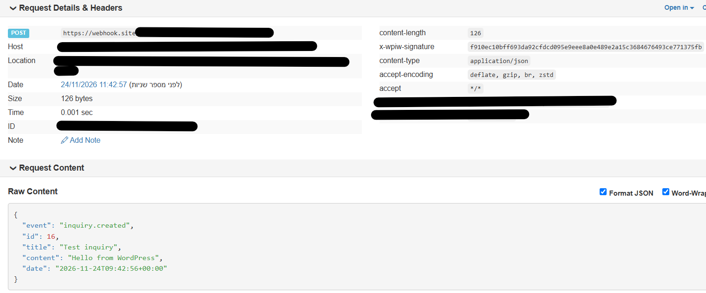

# WP Inquiries Webhook

WordPress plugin demonstrating a Custom Post Type, a custom REST API endpoint, and a signed outgoing webhook. Includes a Dockerized development environment.

## Features

- **Custom Post Type:** `inquiry`, exposed to the REST API
- **REST endpoint:** `GET /wp-json/inquiries/v1/list` (built with `WP_Query`, sanitized parameters, capped `per_page`)
- **Outgoing webhook:** sent once, when an inquiry is first published; payload signed with HMAC-SHA256 in the `X-WPIW-Signature` header so the receiver can verify the sender
- **Non-blocking request:** publishing is never slowed down by a slow receiver
- **Configuration outside the code:** webhook URL and secret live in an untracked `config.php`

## Run locally

Requirements: Docker Desktop.

1. `docker compose up -d`
2. Open http://localhost:8080 and finish the WordPress install
3. In the admin, activate **WP Inquiries Webhook** under Plugins
4. Go to Settings > Permalinks and choose **Post name**
5. Copy `wp-content/plugins/wp-inquiries-webhook/config.sample.php` to `config.php` in the same folder and set your webhook URL and secret (a free test URL is available at https://webhook.site)

## Try it

- Create an inquiry: Inquiries > Add New > Publish
- Read the API: `curl http://localhost:8080/wp-json/inquiries/v1/list`
- Check your webhook receiver for a POST with the JSON payload and signature header



## Verifying the signature (receiver side)

```php
$expected = hash_hmac( 'sha256', $raw_body, $secret );
hash_equals( $expected, $_SERVER['HTTP_X_WPIW_SIGNATURE'] );
```

## Notes

- The list endpoint is public by design for this demo. In production, restrict it with a real `permission_callback`.
- SSL verification is disabled only when `WP_DEBUG` is on (local development).

## Tech

PHP, WordPress hooks, WP_Query, REST API, Webhooks, Docker